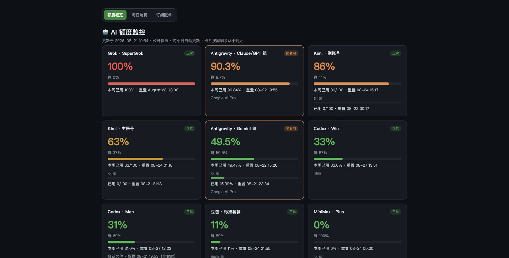

# 🤖 AI Quota Monitor（AI 额度监控）

一条命令汇总 AI 账号的**周额度、短时窗口和重置时间**，附带本地卡片式仪表盘。配置 Sub2API 后，已映射账号由服务器读取，未提供的窗口明确显示为未知。

**📊 线上快照（每天 9:30–23:30 每小时更新）**：https://insistgang.top/ai-quota-monitor/

线上页面分为三个页签：额度概览（含最近两天摘要）、每日消耗（7/30 天切换与账号筛选）和订阅账单。

概览页打开后每分钟检查新版，并原位更新额度卡片；历史页与订阅页提示有新版，保留当前筛选和阅读状态。网页检查不会触发本机采集，采集仍按上述每小时计划执行。页面顶部时间表示页面生成时间，账号卡片中的“数据”时间表示该来源的实际快照时间。

Sub2API 数据源通过已有 SSH 连接在服务器内查询账号额度，凭据不复制到 Mac。配置与原账号名称的映射放在 `~/.cache/ai-quota-monitor/sub2api.json`；映射覆盖的来源停止调用本地 CLI。失败或过期的账号单独重试，成功账号不重复查询，配置错误会阻止写入。详见 [Sub2API 额度接入](docs/sub2api-quota.md)。

本机采集模式保留原有 Grok 日志／官方 `/usage`、Codex 刷新与缓存重试。旧数据会标为缓存／过期，不作为新成功样本计入每日消耗。GitHub 推送仍最多尝试 3 次、每次限时 60 秒；失败保留待推送提交。

豆包采集器和历史数据保留，当前工作区按原有停用规则过滤，不纳入 Sub2API。指定的未付费 Codex 账号仍从公开额度页和历史页隐藏，本地保留“未接入”状态；公开过滤名单位于 `~/.cache/ai-quota-monitor/public-hidden-accounts.json`（权限 `0600`），不进入仓库。配置缺失或无效时，公开页面生成会停止。

订阅账单支持显示 ChatGPT 预存余额、可覆盖的扣费日和下次补款日期。余额按人工核对日期展示，扣费计划不自动记为已发生支出；记录默认仅本地可见，填写经用户授权的“公开展示名”后才会进入公开页面，原始账号名仍保留在本地。



完整的数据流、计算口径、定时发布、容错和隐私设计见 [项目流程与设计说明](docs/project-design.md)。

## 支持的数据源

| 源 | Sub2API 模式的取数方式 |
|---|---|
| Kimi for Coding（双账号） | Sub2API CN 账号额度接口，读取 5h／周窗口 |
| Codex（OpenAI 账号） | 在服务器内使用 Sub2API 当前凭据 GET 官方用量；按实际窗口时长区分 5h／7 天，避开会触发模型探针或自动重置的管理端路径 |
| Grok（SuperGrok） | Sub2API 通用账号 usage 的账单查询路径；使用官方周额度及其实际更新时间 |
| MiniMax | Sub2API CN 账号额度接口；只显示上游本次实际返回的 5h／周窗口 |
| Antigravity（Gemini 组） | Sub2API 分模型额度，以 Gemini 文本模型最高使用率作为周额度 |
| 豆包个人会员 | 保留原 Chrome 可见 DOM 采集器，未接入 Sub2API |

## 用法

```bash
python3 quota_report.py            # 终端表格
python3 quota_report.py --json     # 机器可读输出
QUOTA_SOURCE=sub2api python3 quota_report.py --json  # 要求配置 Sub2API，否则退出
QUOTA_SOURCE=local python3 quota_report.py --json    # 显式使用原本机采集器
python3 quota_report.py --log      # 追加快照到 quota-log.csv（攒每日底账）
python3 quota_report.py --html     # 生成 quota-dashboard.html 仪表盘
python3 quota_report.py --serve    # 本地服务模式：http://127.0.0.1:8788 页面上可点按钮实时刷新
python3 quota_report.py --sync-doubao-chrome  # 单独验证/刷新豆包官网 DOM 快照
./publish.sh                       # 采集 + 生成公开版页面 + 推送 GitHub Pages
```

豆包首次使用前，在 Chrome 打开并登录
[`https://www.doubao.com/member/quota-management`](https://www.doubao.com/member/quota-management)，
然后在 Chrome 的“视图 → 开发者”中开启“允许来自 Apple 事件的 JavaScript”。采集器只刷新这个已打开的额度标签页，等待额度区重新加载后读取可见数字；不会新开页面、点击或读取 Cookie。详细流程及其他 Agent 的导入方式见 [豆包 DOM 接入说明](docs/doubao-dom-sync.md)。

每张卡显示一个账号。主百分比表示周已用，短时／模型窗口单独展示；周窗口未知时主值显示 `—`。颜色按用量变化（🟢<50% / 🟡50-80% / 🟠80-95% / 🔴>95%），供应商返回的超额数值保留原值，进度条宽度最多为 100%。

## 定时自动跑（macOS launchd）

```bash
./scripts/install-launchd-runtime.sh
cp examples/com.leo.quota-report.plist ~/Library/LaunchAgents/
# 把 plist 里的 /Users/YOURNAME 改成你的路径
launchctl load ~/Library/LaunchAgents/com.leo.quota-report.plist
```

默认每天 **9:30–23:30 每小时一次**（共 15 次）。launchd 调用 `~/.local/bin/quota-publish`（不放在文稿目录，避免 macOS TCC 拦截），再由 Python 打开仓库内唯一的 `publish_runtime.py`，执行采集、写 CSV、刷新三个 HTML 页面并推送。手动运行 `publish.sh` 也走同一个 Python 入口，因此没有两份发布逻辑。入口模板更新后重新执行安装命令即可。电脑睡着错过会在唤醒后补跑。

launchd 的 stdout/stderr 默认写入 `~/Library/Logs/ai-quota-monitor/`；安装命令会预先创建该目录。入口和日志都不要放进 `Documents`，否则 Mac 重启后可能被 TCC/System Policy 在脚本启动前拦截。

Sub2API 模式只使用已核对的用量查询路径，不发送模型任务或主动重置额度。Sub2API 会正常更新额度缓存，并可能由自身维护 Grok OAuth 凭据；监控器不实现第二套 OAuth 刷新。原发布入口与运行计划保持不变。

## 依赖

- macOS + Python 3.10+（只用标准库）
- 豆包：Chrome 已登录、额度管理页保持打开；自动同步需允许来自 Apple 事件的 JavaScript
- Sub2API 模式：已有无交互 SSH 登录，服务器具备 Python 3、Docker 和读取 Sub2API 数据库的权限
- 本机模式才需要 `tmux`、已登录的 `codex-auth`／`grok`／`mmx`／`agy`，以及 KimiCodeBar 的账号配置

## 隐私与安全

- Sub2API 模式在服务器内取数，不更改套餐、重置策略或发送模型消息
- 不打印或缓存 key、token、管理员密码摘要；服务器内短期认证只存在于采集进程内存，SSH 只带回允许的额度字段
- 本地静态看板、实时服务和公开网页均默认打码邮箱（如 `f***@163.com`），覆盖卡片、提醒、历史筛选和订阅账单；本地 CSV / JSON 保留原始账号标识用于区分账号
- 豆包只把套餐、百分比、重置时间和采集时间写入 `~/.cache/ai-quota-monitor/doubao-quota.json`（权限 `0600`），不落盘整页 DOM
- `quota-log.csv`、`quota-dashboard.html` 含你的用量数据，已在 .gitignore 排除，不会误传

## 实现说明

`sub2api_quota.py` 负责私有配置、远程读取、窗口归一化与失败重试；`scripts/sub2api_quota_snapshot.py` 在目标服务器执行受限查询。未配置 Sub2API 或显式选择本机模式时，保留原来的 Kimi API、codex-auth、CLI 用量面板和豆包可见 DOM 采集器。

## License

MIT
