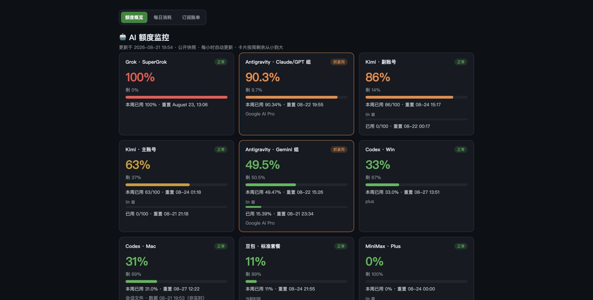

# 🤖 AI Quota Monitor（AI 额度监控）

一条命令汇总 AI 账号的**周额度、短时窗口和重置时间**，附带本地卡片式仪表盘与公开静态页。数据由 Sub2API 服务端读取，Antigravity 辅以 `agy /usage` 补全周窗口。

**📊 线上快照（每天 9:30–23:30 每小时更新）**：https://insistgang.top/ai-quota-monitor/

线上页面分为三个页签：额度概览（含最近两天摘要）、每日消耗（7/30 天切换与账号筛选）和订阅账单（含非 AI 服务如 ikuuu 到期提醒）。

概览页打开后每分钟检查新版，并原位更新额度卡片；历史页与订阅页提示有新版，保留当前筛选和阅读状态。网页检查不会触发本机采集，采集仍按上述每小时计划执行。页面顶部时间表示页面生成时间，账号卡片中的“数据”时间表示该来源的实际快照时间。

Sub2API 数据源通过已有 SSH 连接在服务器内查询账号额度，凭据不复制到 Mac。配置与原账号名称的映射放在 `~/.cache/ai-quota-monitor/sub2api.json`。失败或过期的账号单独重试，成功账号不重复查询，配置错误会阻止写入。详见 [Sub2API 额度接入](docs/sub2api-quota.md)。

已移除豆包 Chrome DOM、本机 CLI（`codex-auth`/`mmx`/Kimi API）等旧采集器；旧数据保留在本地底账中按规则隐藏。GitHub 推送最多尝试 3 次、每次限时 60 秒；失败保留待推送提交。

已停用或未付费账号不纳入监控；公开页隐藏名单位于 `~/.cache/ai-quota-monitor/public-hidden-accounts.json`（权限 `0600`），脱敏替换规则与财务预存记录位于 `~/.cache/ai-quota-monitor/finance.json`（权限 `0600`），均不进入仓库。配置缺失或无效时，公开页面生成会停止。

订阅账单支持显示 ChatGPT 预存余额、可覆盖的扣费日和下次补款日期。余额按人工核对日期展示，扣费计划不自动记为已发生支出；记录默认仅本地可见，填写经用户授权的“公开展示名”后才会进入公开页面，原始账号名仍保留在本地。财务笔记路径与公开脱敏映射可通过 `QUOTA_FINANCE_MD` 或 `~/.cache/ai-quota-monitor/finance.json`（权限 `0600`）配置，不写入仓库。



完整的数据流、计算口径、定时发布、容错和隐私设计见 [项目流程与设计说明](docs/project-design.md)。

## 支持的数据源

| 源 | 取数方式 |
|---|---|
| Kimi for Coding（双账号） | Sub2API CN 账号额度接口，读取 5h／周窗口 |
| Codex（OpenAI 账号） | 在服务器内使用 Sub2API 当前凭据 GET 官方用量；按实际窗口时长区分 5h／7 天 |
| MiniMax | Sub2API CN 账号额度接口；只显示上游本次实际返回的 5h／周窗口 |
| Antigravity（Gemini 组） | Sub2API 分模型额度，辅以 `agy /usage` 补全 Gemini / Claude 组周额度 |
| 非 AI 服务（如 ikuuu） | 从私有财务记录读取到期日期并纳入订阅页与概览紧急提醒 |

## 用法

```bash
python3 quota_report.py            # 终端表格
python3 quota_report.py --json     # 机器可读输出
python3 quota_report.py --log      # 追加快照到 quota-log.csv（攒每日底账）
python3 quota_report.py --html     # 生成 quota-dashboard.html 仪表盘
python3 quota_report.py --serve    # 本地服务模式：http://127.0.0.1:8788 页面上可点按钮实时刷新
./publish.sh                       # 采集 + 生成公开版页面 + 推送 GitHub Pages
```

每张卡显示一个账号。主百分比表示周已用，短时／模型窗口单独展示；周窗口未知时主值显示 `—`。颜色按用量变化（🟢<50% / 🟡50-80% / 🟠80-95% / 🔴>95%），供应商返回的超额数值保留原值，进度条宽度最多为 100%。

## 定时自动跑（macOS launchd）

```bash
./scripts/install-launchd-runtime.sh
cp examples/com.leo.quota-report.plist ~/Library/LaunchAgents/
# 把 plist 里的 /Users/YOURNAME 改成你的路径
launchctl load ~/Library/LaunchAgents/com.leo.quota-report.plist
```

默认每天 **9:30–23:30 每小时一次**（共 15 次）。launchd 调用 `~/.local/bin/quota-publish`（不放在文稿目录，避免 macOS TCC 拦截），再由 Python 打开仓库内唯一的 `publish_runtime.py`，执行采集、写 CSV、刷新三个 HTML 页面并推送。手动运行 `publish.sh` 也走同一个 Python 入口，因此没有两份发布逻辑。入口模板更新后重新执行安装命令即可。电脑睡着错过会在唤醒后补跑。

launchd 的 stdout/stderr 默认写入 `~/Library/Logs/ai-quota-monitor/`；安装命令会预先创建该目录。入口和日志都不要放进 `Documents`，否则 Mac 重启后可能被 TCC/System Policy 在脚本启动前拦截。

Sub2API 模式只使用已核对的用量查询路径，不发送模型任务或主动重置额度。Sub2API 会正常更新额度缓存；监控器不实现第二套 OAuth 刷新。原发布入口与运行计划保持不变。

## 依赖

- macOS + Python 3.10+（只用标准库）
- Sub2API：已有无交互 SSH 登录，服务器具备 Python 3、Docker 和读取 Sub2API 数据库的权限
- Antigravity 周窗口补全：`tmux` + 已登录 `agy`

## 隐私与安全

- 只在 Sub2API 服务器内查询只读额度接口，不更改套餐、重置策略或发送模型消息
- 不打印或缓存 key、token、管理员密码摘要；服务器内短期认证只存在于采集进程内存，SSH 只带回允许的额度字段
- 本地静态看板、实时服务和公开网页均默认打码邮箱（如 `f***@163.com`），公开页额外应用 `~/.cache/ai-quota-monitor/finance.json` 的 `public_replacements` 剔除实名、银行与私有账号昵称；本地底账保留原始账号标识用于连续统计
- `quota-log.csv`、`quota-dashboard.html` 含你的用量数据，已在 .gitignore 排除，不会误传

## 实现说明

`sub2api_quota.py` 负责私有配置、远程读取、窗口归一化与失败重试；`scripts/sub2api_quota_snapshot.py` 在目标服务器执行受限查询；`quota_report.py` 负责 Antigravity `agy /usage` 周窗口补全、财务与非 AI 续费整合、历史计算和页面渲染。

## License

MIT
