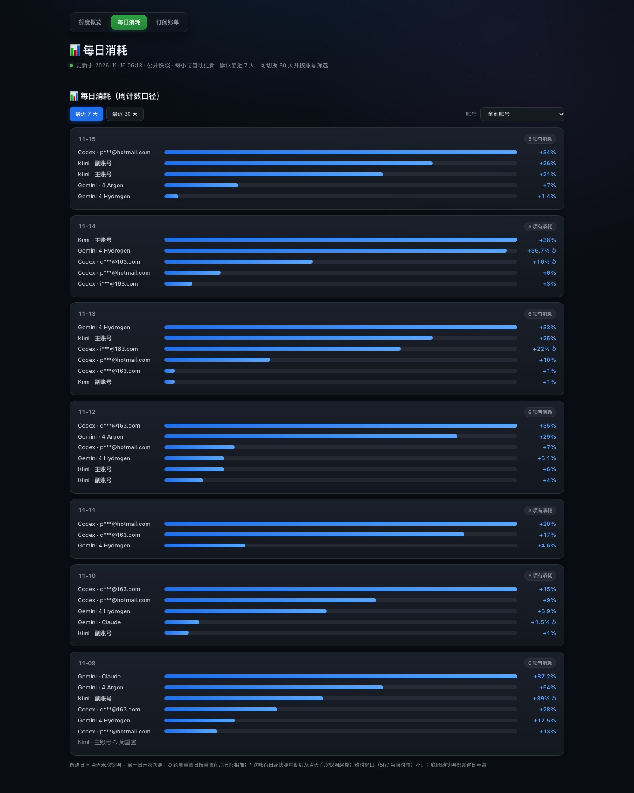
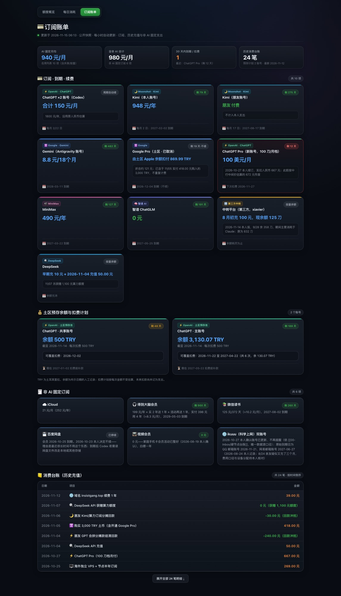

<p align="center">
  简体中文 · <a href="./README_EN.md">English</a>
</p>

<!-- README_SYNC: source=working-tree; updated=2026-11-18 -->

<div align="center">

# 🤖 AI Quota Monitor

### 把散在多个 AI 账号里的额度窗口，收进一张每小时更新的看板

[](https://github.com/insistgang/ai-quota-monitor/stargazers)
[](#技术栈与运行环境)
[](./LICENSE)
[](https://github.com/insistgang/ai-quota-monitor/issues)
[](https://github.com/insistgang/ai-quota-monitor/commits/main)

**如果它替你少开了三个客户端面板，点个 Star，让更多被额度折磨的人找到它。**


</div>

## 这是什么

AI 编程账号的额度散在各个客户端和网页里：有的只显示 5 小时窗口，有的只给周额度，有的干脆不告诉你还剩多少。要弄清「该先续哪个、这个月用了多少」，只能一个个切窗口去看。

AI Quota Monitor 把这些数字收成一张表和三个网页：一条命令汇总多个账号的**周额度、5 小时短时窗口和重置时间**，同时产出终端表格、本地卡片式仪表盘和三个公开静态页。

Codex、Kimi、MiniMax 经 SSH 在 Sub2API 服务器内查询。Antigravity 直接读取本机已登录的 `agy` CLI：按实际返回的模型组显示共享额度，不为单个模型虚构独立额度。两种采集方式都不发送模型任务、不触发额度重置。

**📊 线上快照（每天 9:30–23:30 每小时更新）**：https://insistgang.top/ai-quota-monitor/

## 主要功能

- **统一额度口径**：把各供应商不同定义的 5 小时窗、周窗口归一化成同一套字段（周已用百分比、重置时间、可选短时窗口）
- **一眼看出该管谁**：卡片按周剩余从少到多排列；周额度见底或 5 小时窗接近耗尽时单独提醒
- **三种输出**：终端表格、机器可读的 `--json`、本地卡片看板 `--html`
- **每日消耗底账**：`--log` 追加快照到 `quota-log.csv`，跨周重置也能分段算出真实日均
- **公开三页**：额度概览、每日消耗、订阅账单，脱敏后发布到 GitHub Pages
- **订阅账单**：AI 订阅与非 AI 续费（如 `ikuuu`）到期提醒，ChatGPT 预存余额与扣费计划
- **定时发布**：macOS launchd 每小时跑一次，采集 → 写底账 → 刷新三页 → 推送，全程只有一个入口
- **失败降级**：某个源读不到时保留上次有效快照并标注原因，不伪装实时，也不写成 0%
- **隐私隔离**：公开页默认打码邮箱并剔除实名、银行与私有昵称；底账和本地看板留在本机，不进仓库

## 不用它，你要做什么

| 方案 | 你要做什么 | 拿不到什么 |
| --- | --- | --- |
| 逐个客户端查 | 每个账号切一次界面 | 跨账号汇总、重置倒计时、连续历史 |
| 各厂商用量页 | 逐个站点登录 | 中转账号的真实窗口、跨周统计 |
| Sub2API 后台 | 看中转侧流水 | 窗口口径归一化、每日消耗底账、公开看板 |
| **AI Quota Monitor** | 一条命令，或每小时自动跑 | — |

## 线上看板

三个页签分别回答三种问题：现在该管哪个账号、这个月烧了多少、还有哪些订阅要到期。

### 额度概览


卡片按周剩余从少到多排列，最需要处理的账号靠前。主百分比是供应商实际返回的周已用；5 小时窗单独显示，不混进周额度。周窗口未知时显示 `—`，不用 0% 假装已知。

### 每日消耗



普通日按「当天最后一份快照 − 前一天最后一份快照」计算；周重置日把重置前后分段相加；缺快照时不把几天用量全记到恢复当天。

### 订阅账单



AI 订阅之外，也纳入非 AI 服务的续费提醒（如 `ikuuu`）。ChatGPT 预存余额按人工核对日期展示，未来扣款只作为计划，不会自动记成已发生支出。

> 页面顶部时间是页面生成时间，账号卡片上的“数据”时间是该来源的实际快照时间。网页每分钟检查一次新版并原位更新额度卡片，**查看网页不会触发本机采集**。

## 快速开始

```bash
git clone https://github.com/insistgang/ai-quota-monitor.git
cd ai-quota-monitor
python3 quota_report.py --html     # build the local card dashboard
open quota-dashboard.html           # open it in a browser
```

要在真实环境采集，还需要先配置 Sub2API 私有映射（`~/.cache/ai-quota-monitor/sub2api.json`，权限 `0600`）。配置缺失时程序会直接报错并以退出码 2 结束，不会拿空数据凑一份快照。配置结构与服务器权限要求见 [Sub2API 额度接入](docs/sub2api-quota.md)。

Antigravity 为可选来源。在同一个系统用户下安装并登录 `agy` 后即可采集，无需在 Sub2API 添加账号。`agy --print "/usage" --output-format json` 应返回结构化额度；已在 CLI 1.5.10 实测。程序从 `PATH` 或 `~/.local/bin/agy` 查找 CLI，找不到时只采集 Sub2API。

常用命令：

```bash
python3 quota_report.py            # terminal table
python3 quota_report.py --json     # machine-readable output
python3 quota_report.py --log      # append a snapshot to quota-log.csv (daily ledger)
python3 quota_report.py --html     # render quota-dashboard.html
python3 quota_report.py --serve    # local server mode: http://127.0.0.1:8788 with a refresh button
./publish.sh                       # collect + render public pages + push to GitHub Pages
```

其余参数：

| 参数 | 作用 |
| --- | --- |
| `--public-html <路径>` | 生成脱敏公开版页面。会额外写出同目录的 `history.html` 与 `subscriptions.html` |
| `--port <端口>` | 配合 `--serve`，默认 `8788` |
| `--retry-failures <次数>` | 对异常来源额外重试的次数 |
| `--retry-delay <秒>` | 重试间隔，默认 `15` |
| `--max-unhealthy <数量>` | 异常来源超过该数量、且至少一个无缓存可用时取消写入；负数表示不限制 |

## 配置

程序本身不带任何凭据。所有私有配置都在本机 `~/.cache/ai-quota-monitor/` 下，权限应为 `0600`，均不进入仓库：

| 文件 | 作用 | 缺失时的行为 |
| --- | --- | --- |
| `sub2api.json` | SSH 别名、账号 ID、平台与看板名称映射 | 命令行报错退出，不写入任何数据 |
| `public-hidden-accounts.json` | 不公开的账号名单 | 停止生成公开页面 |
| `finance.json` | 财务笔记路径与公开脱敏映射 | 公开页生成失败 |
| `last-good.json` | 每个来源最近一次有效快照 | 采集失败时无缓存可用，仍受异常数量门槛限制 |

可用环境变量改路径或行为：

| 环境变量 | 作用 | 默认值 |
| --- | --- | --- |
| `QUOTA_SUB2API_CONFIG` | Sub2API 私有配置路径 | `~/.cache/ai-quota-monitor/sub2api.json` |
| `QUOTA_PUBLIC_HIDDEN_ACCOUNTS` | 公开过滤名单路径 | `~/.cache/ai-quota-monitor/public-hidden-accounts.json` |
| `QUOTA_FINANCE_CONFIG` | 财务私有配置路径 | `~/.cache/ai-quota-monitor/finance.json` |
| `QUOTA_FINANCE_MD` | 财务笔记路径（Markdown） | 由 `finance.json` 中的 `finance_md` 指定 |
| `QUOTA_LAST_GOOD` | 最近成功快照缓存路径 | `~/.cache/ai-quota-monitor/last-good.json` |
| `QUOTA_MONITOR_HOME` | 仓库根目录（launchd 入口用） | `~/Desktop/个人工具/ai-quota-monitor` |
| `QUOTA_RUNTIME_BIN_DIR` | launchd 入口安装目录 | `~/.local/bin` |
| `QUOTA_PYTHON_BIN` | 使用的 Python 解释器 | `python3` |

财务笔记（Markdown）本身缺失或读不到时，公开页仍会生成，只是没有订阅与账单内容。

## 支持的数据源

| 源 | 取数方式 |
|---|---|
| Kimi for Coding（双账号） | Sub2API CN 账号额度接口，读取 5h／周窗口 |
| Codex（OpenAI 账号） | 在服务器内使用 Sub2API 当前凭据 GET 官方用量；按实际窗口时长区分 5h／7 天 |
| MiniMax | Sub2API CN 账号额度接口；只显示上游本次实际返回的 5h／周窗口 |
| Antigravity（Gemini、Claude / GPT-OSS、Gemini 4 Argon） | 本机 CLI 的分组额度，展示实际返回的周窗、5 小时窗及重置时间 |
| 非 AI 服务（如 ikuuu） | 从私有财务记录读取到期日期并纳入订阅页与概览紧急提醒 |

当前快照覆盖 6 个 Sub2API 账号（Kimi ×2、Codex ×3、MiniMax ×1）及 3 个 Antigravity 额度组：Gemini 与 Claude / GPT-OSS 共享池各有周窗和 5 小时窗，Gemini 4 Argon 为单独的周额度。旧 Antigravity 历史保留，不与新口径混算；豆包已不再接入额度采集，其会员在订阅页显示到期提醒，但不进入额度卡片与每日消耗。

## 定时自动跑（macOS launchd）

```bash
./scripts/install-launchd-runtime.sh
cp examples/com.leo.quota-report.plist ~/Library/LaunchAgents/
# replace /Users/YOURNAME in the plist with your own path
launchctl load ~/Library/LaunchAgents/com.leo.quota-report.plist
```

默认每天 **9:30–23:30 每小时一次**（共 15 次）。launchd 调用 `~/.local/bin/quota-publish`（不放在文稿目录，避免 macOS TCC 拦截），再由 Python 打开仓库内唯一的 `publish_runtime.py`，执行采集、写 CSV、刷新三个 HTML 页面并推送。手动运行 `publish.sh` 也走同一个 Python 入口，因此没有两份发布逻辑。

几点需要注意：

- plist 里的 `/Users/YOURNAME` 有三处（入口脚本、日志路径），安装时要全部替换成你的用户名
- 入口脚本默认认为仓库在 `~/Desktop/个人工具/ai-quota-monitor`；克隆到别的位置时，用 `QUOTA_MONITOR_HOME` 指过去
- 睡眠期间错过的时间点会在唤醒后补跑；关机期间不会运行，开机后等下一个计划时间
- launchd 的 stdout/stderr 写入 `~/Library/Logs/ai-quota-monitor/`，安装命令会预先创建该目录；入口和日志都不要放进 `Documents`，否则 Mac 重启后可能被 TCC/System Policy 在脚本启动前拦截

## 隐私与安全

- Sub2API 查询在服务器内完成；Antigravity 只调用已登录 CLI 的额度命令，不读取或复制本机 OAuth 凭据
- 不打印或缓存 key、token、管理员密码摘要；服务器内短期认证只存在于采集进程内存，SSH 只带回允许的额度字段
- 本地静态看板、实时服务和公开网页均默认打码邮箱（如 `f***@163.com`），公开页额外应用 `finance.json` 的 `public_replacements` 剔除实名、银行与私有账号昵称；本地底账保留原始账号标识用于连续统计
- `quota-log.csv`、`quota-dashboard.html` 含你的用量数据，已在 `.gitignore` 排除，不会误传

## 口径与边界

- 主百分比是“本周已用”，剩余量按 `100 - used_pct` 计算；供应商返回的超额数值保留原值，进度条宽度最多 100%
- 5 小时短窗不计入“每日消耗”，否则同一使用行为会被重复计算
- 周额度已用完（剩余 ≤ 3%）时不再提示“抓紧用”，卡片改显示“已用完”
- 采集失败时保留最后一份有效快照并标明失败原因，不伪装实时，也不写成 0%
- GitHub 推送最多尝试 3 次、每次限时 60 秒；失败保留本地待推送提交，等下一个计划任务补发

## 技术栈与运行环境

| 组成 | 用在哪里 | 说明 |
| --- | --- | --- |
| Python 3.10+ | `quota_report.py`、`sub2api_quota.py`、`publish_runtime.py` | 只用标准库，不需要 `pip install` |
| Bash | `publish.sh`、`scripts/*.sh` | 手动发布与 launchd 入口 |
| SSH | 本机 → Sub2API 服务器 | 无交互登录，把受限查询脚本送过去执行 |
| Sub2API | 额度来源 | 需服务器上 Python 3、Docker 与读取 `sub2api-db` 的权限 |
| `agy`（可选） | 本机 Antigravity 额度 | 原生 JSON 状态命令，无需终端自动化 |
| macOS launchd | 定时发布 | 每天 9:30–23:30 每小时一次 |
| GitHub Pages | 公开三页 | 从 `main` 分支的 `docs/` 目录构建 |

## 项目结构

```text
ai-quota-monitor/
├── quota_report.py              # 汇总额度、每日计算、HTML 生成
├── agy_quota.py                 # 本机 Antigravity 共享额度查询
├── sub2api_quota.py             # 私有映射、SSH 读取、窗口校验、账号级重试
├── publish_runtime.py           # 唯一的生成、提交、推送流程
├── publish.sh                   # 手动发布入口
├── scripts/
│   ├── sub2api_quota_snapshot.py    # 服务器内受限用量查询，不返回凭据
│   ├── quota-publish-launchd.sh     # 安装到 Documents 外的稳定 launchd 入口
│   └── install-launchd-runtime.sh   # 安装入口脚本并创建日志目录
├── docs/
│   ├── index.html               # 额度概览
│   ├── history.html             # 每日消耗
│   ├── subscriptions.html       # 订阅账单
│   ├── project-design.md        # 数据流、计算口径、容错与隐私设计
│   ├── sub2api-quota.md         # Sub2API 接入、权限边界与配置结构
│   └── assets/                  # README 用的真实页面截图
├── examples/
│   └── com.leo.quota-report.plist  # launchd 计划任务模板
├── tests/                       # 129 项回归测试
├── README.md / README_EN.md     # 中英文说明
├── ROADMAP.md                   # 进度与验证记录
└── LICENSE
```

运行后额外产生两个不入库的产物：`quota-log.csv`（每日底账）和 `quota-dashboard.html`（本地看板），两者都已在 `.gitignore` 中排除。

## 本地开发与测试

```bash
python3 -B -m unittest discover -s tests -q
python3 -m py_compile quota_report.py agy_quota.py sub2api_quota.py publish_runtime.py scripts/sub2api_quota_snapshot.py
bash -n publish.sh scripts/*.sh
```

129 项测试覆盖额度计算、CLI 解析、Sub2API 读取与重试、脱敏和发布流程。验收清单见 [项目流程与设计说明](docs/project-design.md)。

> 数据源说明最后核对时间：2026-11-18。

## License

[MIT](./LICENSE)。仓库同时保留作者本机的用量数据处理逻辑，公开部分只包含经脱敏的额度、账单与汇总。

## 支持

如果它替你少开过几个客户端面板、或者让“还剩多少额度”这件事不用再靠回忆，给个 Star 就是最直接的反馈。

遇到额度口径不对、某个源读不到、或者想加一个数据源，欢迎开 [Issue](https://github.com/insistgang/ai-quota-monitor/issues) 带上日志片段。
