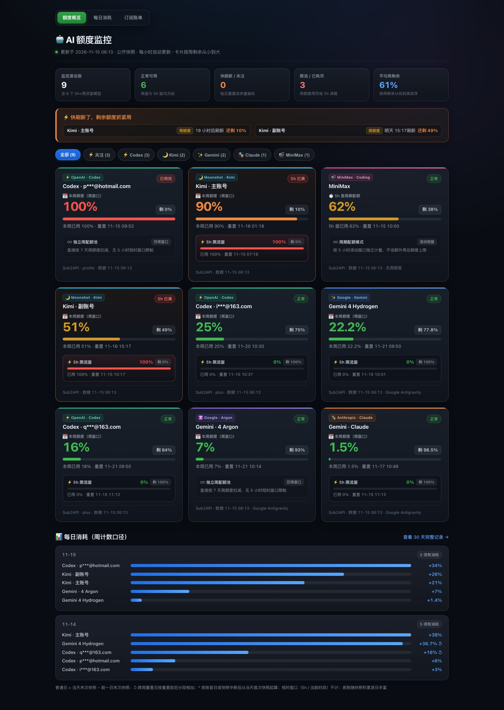

<p align="center">
  简体中文 · <a href="./README_EN.md">English</a>
</p>

<!-- README_SYNC: source=main@85ac18c; updated=2026-11-15 -->

<div align="center">

# 🤖 AI Quota Monitor

### 把散在多个 AI 账号里的额度窗口，收进一张每小时更新的看板

[](https://github.com/insistgang/ai-quota-monitor/stargazers)
[](#依赖)
[](./LICENSE)
[](https://github.com/insistgang/ai-quota-monitor/issues)
[](https://github.com/insistgang/ai-quota-monitor/commits/main)

**如果它替你少开了三个客户端面板，点个 Star，让更多被额度折磨的人找到它。**



</div>

## 这是什么

一条命令汇总多个 AI 编程账号的**周额度、5 小时短时窗口和重置时间**，同时产出终端表格、本地卡片式仪表盘和三个公开静态页。

数据不在本机采集：额度经已有 SSH 连接在 Sub2API 服务器内只读查询，Antigravity 额外用 `agy /usage` 补全 Gemini / Claude 组的周窗口。全程只读，不发送模型任务、不触发额度重置。

**📊 线上快照（每天 9:30–23:30 每小时更新）**：https://insistgang.top/ai-quota-monitor/

## 不用它，你要做什么

| 方案 | 你要做什么 | 拿不到什么 |
| --- | --- | --- |
| 逐个客户端查 | 每个账号切一次界面 | 跨账号汇总、重置倒计时、连续历史 |
| 各厂商用量页 | 逐个站点登录 | 中转账号的真实窗口、跨周统计 |
| Sub2API 后台 | 看中转侧流水 | 窗口口径归一化、每日消耗底账、公开看板 |
| **AI Quota Monitor** | 一条命令，或每小时自动跑 | — |

## 线上看板

三个页签分别回答三种问题：现在该管哪个账号、这个月烧了多少、还有哪些订阅要到期。

### 额度概览


卡片按周剩余从少到多排列，最需要处理的账号靠前。主百分比是供应商实际返回的周已用；5 小时窗单独显示，不混进周额度。周窗口未知时显示 `—`，不用 0% 假装已知。

### 每日消耗


普通日按「当天最后一份快照 − 前一天最后一份快照」计算；周重置日把重置前后分段相加；缺快照时不把几天用量全记到恢复当天。

### 订阅账单


AI 订阅之外，也纳入非 AI 服务的续费提醒（如 `ikuuu`）。ChatGPT 预存余额按人工核对日期展示，未来扣款只作为计划，不会自动记成已发生支出。

> 页面顶部时间是页面生成时间，账号卡片上的“数据”时间是该来源的实际快照时间。网页每分钟检查一次新版并原位更新额度卡片，**查看网页不会触发本机采集**。

## 快速开始

```bash
git clone https://github.com/insistgang/ai-quota-monitor.git
cd ai-quota-monitor
python3 quota_report.py --html     # build the local card dashboard
open quota-dashboard.html           # open it in a browser
```

要在真实环境采集，还需要先配置 Sub2API 私有映射（`~/.cache/ai-quota-monitor/sub2api.json`，权限 `0600`）；配置缺失时程序会直接报错并拒绝写入，不会拿空数据凑一份快照。做法见 [Sub2API 额度接入](docs/sub2api-quota.md)。

常用命令：

```bash
python3 quota_report.py            # terminal table
python3 quota_report.py --json     # machine-readable output
python3 quota_report.py --log      # append a snapshot to quota-log.csv (daily ledger)
python3 quota_report.py --html     # render quota-dashboard.html
python3 quota_report.py --serve    # local server mode: http://127.0.0.1:8788 with a refresh button
./publish.sh                       # collect + render public pages + push to GitHub Pages
```

## 监控哪些账号

| 源 | 取数方式 |
|---|---|
| Kimi for Coding（双账号） | Sub2API CN 账号额度接口，读取 5h／周窗口 |
| Codex（OpenAI 账号） | 在服务器内使用 Sub2API 当前凭据 GET 官方用量；按实际窗口时长区分 5h／7 天 |
| MiniMax | Sub2API CN 账号额度接口；只显示上游本次实际返回的 5h／周窗口 |
| Antigravity（Gemini 组） | Sub2API 分模型额度，辅以 `agy /usage` 补全 Gemini / Claude 组周额度 |
| 非 AI 服务（如 ikuuu） | 从私有财务记录读取到期日期并纳入订阅页与概览紧急提醒 |

当前线上快照覆盖 9 个账号：Kimi ×2、Codex ×3、MiniMax ×1、Antigravity ×3。豆包 DOM 采集和旧本机 CLI 采集器已下线移除，历史底账中的旧记录在展示层过滤。

## 定时自动跑（macOS launchd）

```bash
./scripts/install-launchd-runtime.sh
cp examples/com.leo.quota-report.plist ~/Library/LaunchAgents/
# replace /Users/YOURNAME in the plist with your own path
launchctl load ~/Library/LaunchAgents/com.leo.quota-report.plist
```

默认每天 **9:30–23:30 每小时一次**（共 15 次）。launchd 调用 `~/.local/bin/quota-publish`（不放在文稿目录，避免 macOS TCC 拦截），再由 Python 打开仓库内唯一的 `publish_runtime.py`，执行采集、写 CSV、刷新三个 HTML 页面并推送。手动运行 `publish.sh` 也走同一个 Python 入口，因此没有两份发布逻辑。电脑睡着错过会在唤醒后补跑。

launchd 的 stdout/stderr 默认写入 `~/Library/Logs/ai-quota-monitor/`；安装命令会预先创建该目录。入口和日志都不要放进 `Documents`，否则 Mac 重启后可能被 TCC/System Policy 在脚本启动前拦截。

## 隐私与安全

- 只在 Sub2API 服务器内查询只读额度接口，不更改套餐、重置策略或发送模型消息
- 不打印或缓存 key、token、管理员密码摘要；服务器内短期认证只存在于采集进程内存，SSH 只带回允许的额度字段
- 本地静态看板、实时服务和公开网页均默认打码邮箱（如 `f***@163.com`），公开页额外应用 `~/.cache/ai-quota-monitor/finance.json` 的 `public_replacements` 剔除实名、银行与私有账号昵称；本地底账保留原始账号标识用于连续统计
- `quota-log.csv`、`quota-dashboard.html` 含你的用量数据，已在 `.gitignore` 排除，不会误传
- 公开过滤名单位于 `~/.cache/ai-quota-monitor/public-hidden-accounts.json`（权限 `0600`），配置缺失或无效时停止生成公开页面

## 口径与边界

- 主百分比是“本周已用”，剩余量按 `100 - used_pct` 计算；供应商返回的超额数值保留原值，进度条宽度最多 100%
- 5 小时短窗不计入“每日消耗”，否则同一使用行为会被重复计算
- 周额度已用完（剩余 ≤ 3%）时不再提示“抓紧用”，卡片改显示“已用完”
- 采集失败时保留最后一份有效快照并标明失败原因，不伪装实时，也不写成 0%
- GitHub 推送最多尝试 3 次、每次限时 60 秒；失败保留本地待推送提交，等下一个计划任务补发

完整的数据流、计算口径、定时发布、容错和隐私设计见 [项目流程与设计说明](docs/project-design.md)。

## 项目结构

```text
ai-quota-monitor/
├── quota_report.py              # Sub2API 归一化、Antigravity 周窗口补全、每日计算、HTML 生成
├── sub2api_quota.py             # 私有映射、SSH 读取、窗口校验、账号级重试
├── scripts/
│   ├── sub2api_quota_snapshot.py    # 服务器内受限用量查询，不返回凭据
│   ├── quota-publish-launchd.sh     # 安装到 Documents 外的稳定 launchd 入口
│   └── install-launchd-runtime.sh
├── publish_runtime.py           # 唯一的生成、提交、推送流程
├── publish.sh                   # 手动发布入口
├── docs/
│   ├── index.html               # 额度概览
│   ├── history.html             # 每日消耗
│   ├── subscriptions.html       # 订阅账单
│   ├── project-design.md        # 数据流与口径说明
│   ├── sub2api-quota.md         # Sub2API 接入与权限边界
│   └── assets/                  # README 用的真实页面截图
├── examples/
│   └── com.leo.quota-report.plist
└── tests/                       # 117 项额度计算、隐私、HTML 转义与发布回归测试
```

## 依赖

- macOS + Python 3.10+（只用标准库，无需 pip 安装）
- Sub2API：已有无交互 SSH 登录，服务器具备 Python 3、Docker 和读取 Sub2API 数据库的权限
- Antigravity 周窗口补全：`tmux` + 已登录 `agy`
- 定时发布：macOS launchd

## 本地开发与测试

```bash
python3 -B -m unittest discover -s tests -q
python3 -m py_compile quota_report.py sub2api_quota.py publish_runtime.py scripts/sub2api_quota_snapshot.py
bash -n publish.sh scripts/*.sh
```

117 项测试覆盖额度计算口径、每日消耗分段、脱敏与公开替换、HTML 转义、失败降级和发布流程。完整验收清单见 [项目流程与设计说明](docs/project-design.md)。

## License

[MIT](./LICENSE)。仓库同时保留作者本机的用量数据处理逻辑，公开部分只包含经脱敏的额度、账单与汇总。

## 支持

如果它替你少开过几个客户端面板、或者让“还剩多少额度”这件事不用再靠回忆，给个 Star 就是最直接的反馈。

遇到额度口径不对、某个源读不到、或者想加一个数据源，欢迎开 [Issue](https://github.com/insistgang/ai-quota-monitor/issues) 带上日志片段。
