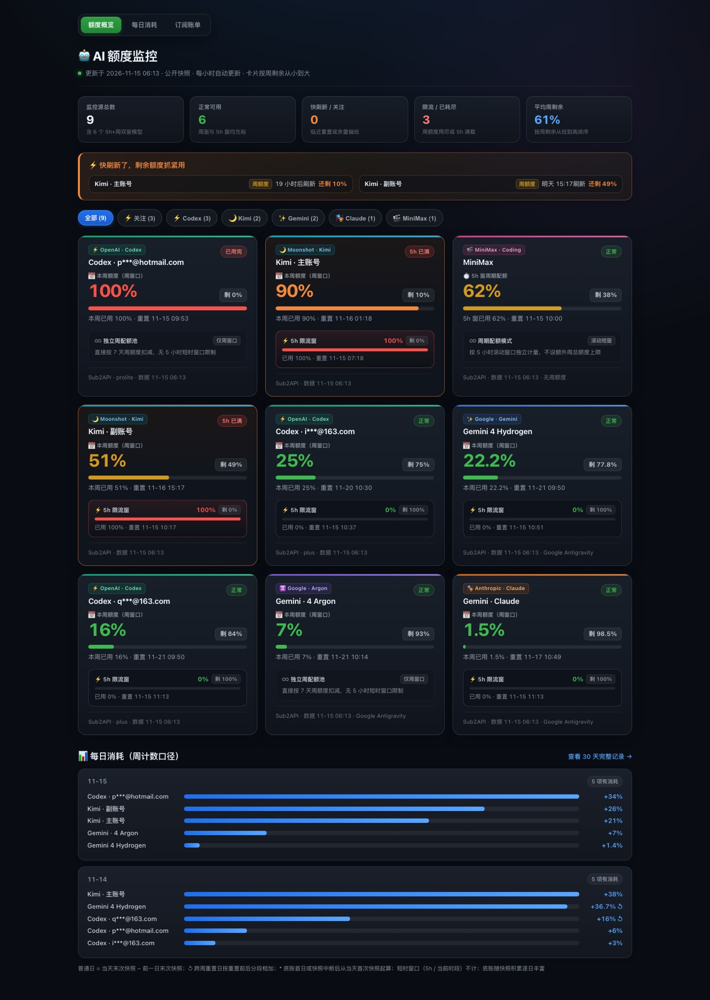
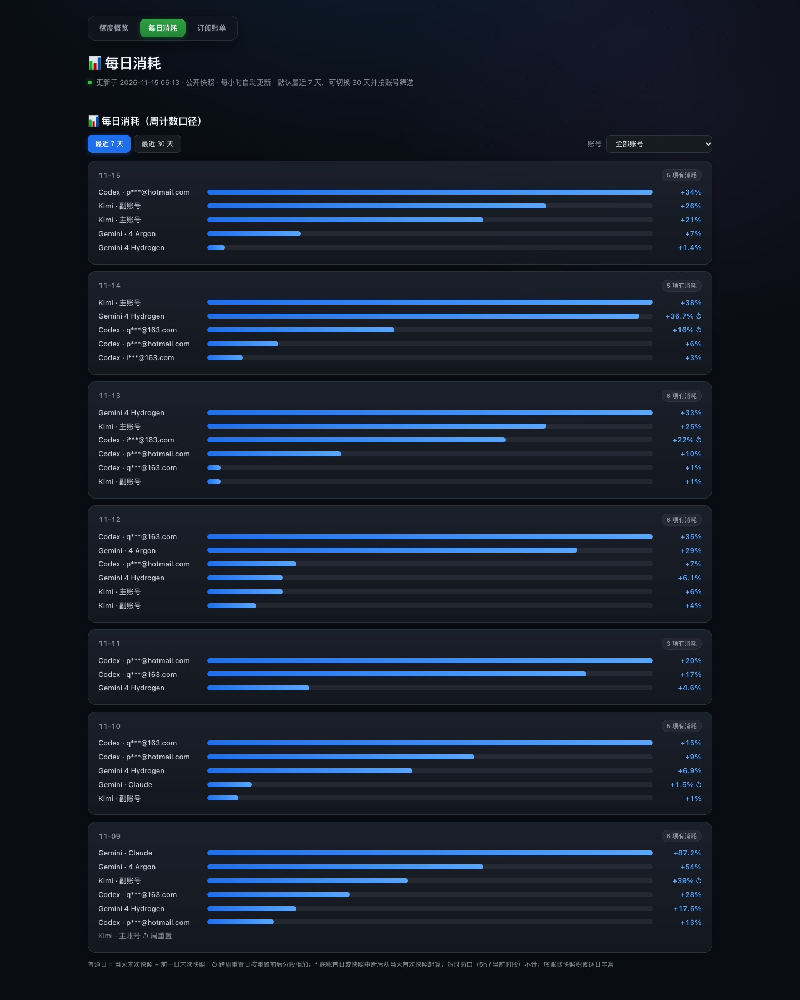
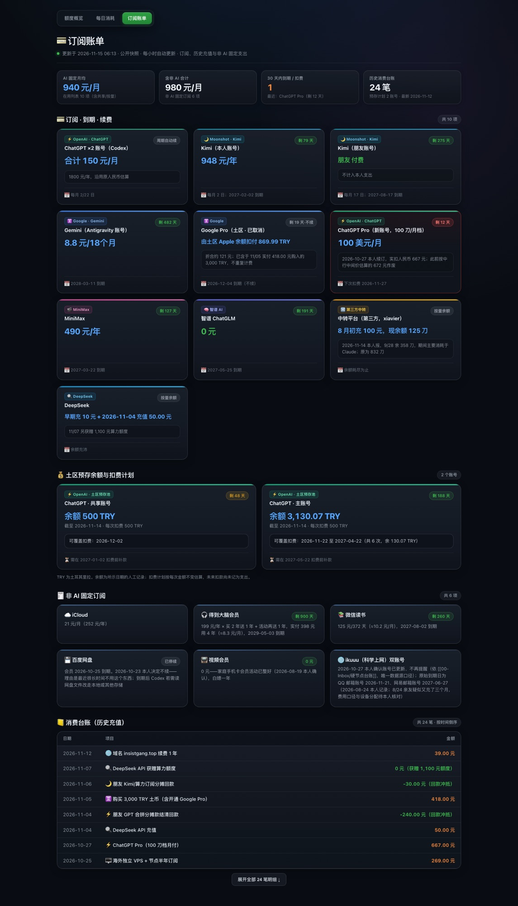

<p align="center">
  <a href="./README.md">简体中文</a> · English
</p>

<!-- README_SYNC: source=working-tree; updated=2026-11-18 -->

<div align="center">

# 🤖 AI Quota Monitor

### Every AI account's quota window, on one board that refreshes every hour

[](https://github.com/insistgang/ai-quota-monitor/stargazers)
[](#tech-stack-and-requirements)
[](./LICENSE)
[](https://github.com/insistgang/ai-quota-monitor/issues)
[](https://github.com/insistgang/ai-quota-monitor/commits/main)

**If it saved you from opening three different clients, a Star helps more people stuck with the same quota anxiety find it.**



</div>

## What it is

AI coding quotas live in separate clients and web pages: some only show a 5-hour window, some only a weekly limit, some refuse to tell you what is left at all. Working out which subscription to renew first, and how much this month already cost, means switching windows one by one.

AI Quota Monitor collects those numbers into one table and three web pages: a single command that reads the **weekly quota, 5-hour rolling window and reset time** of several accounts, and renders a terminal table, a local card-style dashboard and three public static pages.

Codex, Kimi and MiniMax are queried on the Sub2API server over SSH. Antigravity uses the locally signed-in `agy` CLI and shows shared model pools, not invented per-model limits. These quota queries do not run model tasks or reset quota.

**📊 Live snapshot (updated hourly, 9:30–23:30 daily)**: https://insistgang.top/ai-quota-monitor/

## Features

- **One quota vocabulary**: 5-hour windows and weekly limits defined differently by each vendor are normalized into the same fields (weekly used percentage, reset time, optional short window)
- **See who needs attention first**: cards are ordered by remaining weekly quota; exhausted weekly quotas and nearly empty 5-hour windows get their own alerts
- **Three outputs**: a terminal table, machine-readable `--json`, and a local card dashboard via `--html`
- **A daily spend ledger**: `--log` appends snapshots to `quota-log.csv`, and daily spend is still split correctly across a weekly reset
- **Three public pages**: quota overview, daily spend and subscriptions, masked and published to GitHub Pages
- **Subscriptions and billing**: AI subscriptions next to non-AI renewals (such as `ikuuu`), plus ChatGPT prepaid balance and deduction plans
- **Scheduled publishing**: macOS launchd runs it hourly — collect → write ledger → refresh the three pages → push, all through a single entry point
- **Graceful degradation**: when one source fails, the last valid snapshot is kept and labelled with the reason instead of pretending to be live or writing 0%
- **Privacy isolation**: public pages mask emails by default and strip real names, bank names and private nicknames; the ledger and local dashboard stay on your machine

## What you do without it

| Option | What you have to do | What you never get |
| --- | --- | --- |
| Check each client | Switch windows per account | One cross-account view, reset countdowns, continuous history |
| Vendor usage pages | Log into each site | Real windows of relayed accounts, cross-week totals |
| Sub2API dashboard | Read the relay's raw log | Normalized windows, a daily-spend ledger, a public board |
| **AI Quota Monitor** | Run one command, or let it run hourly | — |

## The live board

Three tabs answer three different questions: which account needs attention now, how much this month cost, and which subscriptions expire soon.

### Quota overview


Cards are ordered by remaining weekly quota, so the account that needs action comes first. The main percentage is the weekly usage the vendor actually reported; the 5-hour window is shown separately and never mixed into the weekly number. An unknown weekly window shows `—` instead of a fake 0%.

### Daily spend



A normal day is the last snapshot of today minus the last snapshot of yesterday. On a reset day the two halves are added separately, and a day with missing snapshots never absorbs several days of usage.

### Subscriptions and billing



Non-AI renewals are tracked next to AI subscriptions (for example `ikuuu`). ChatGPT prepaid balance is shown as of the date it was checked manually, and a future deduction stays a plan — it is never booked as spend that already happened.

> The time at the top of a page is the page generation time; the "data" time on a card is when that source was actually sampled. Pages check for a new version every minute and update cards in place — **opening a page never triggers collection on your machine**.

## Quick start

```bash
git clone https://github.com/insistgang/ai-quota-monitor.git
cd ai-quota-monitor
python3 quota_report.py --html     # build the local card dashboard
open quota-dashboard.html           # open it in a browser
```

To collect real data you also need the private Sub2API mapping at `~/.cache/ai-quota-monitor/sub2api.json` (mode `0600`). When it is missing, the program fails loudly with exit code 2 instead of publishing an empty snapshot. The configuration structure and the server permissions are described in [Sub2API quota access](docs/sub2api-quota.md) (Chinese).

Antigravity is optional. Install and sign in to `agy` as the system user running the monitor; no Sub2API account is needed for this source. `agy --print "/usage" --output-format json` should return structured quota data; verified with CLI 1.5.10. The monitor looks for the CLI on `PATH` or at `~/.local/bin/agy` and collects only Sub2API quotas if it is not found.

Common commands:

```bash
python3 quota_report.py            # terminal table
python3 quota_report.py --json     # machine-readable output
python3 quota_report.py --log      # append a snapshot to quota-log.csv (daily ledger)
python3 quota_report.py --html     # render quota-dashboard.html
python3 quota_report.py --serve    # local server mode: http://127.0.0.1:8788 with a refresh button
./publish.sh                       # collect + render public pages + push to GitHub Pages
```

The remaining flags:

| Flag | What it does |
| --- | --- |
| `--public-html <path>` | Renders the masked public pages; also writes `history.html` and `subscriptions.html` next to it |
| `--port <port>` | Used with `--serve`, default `8788` |
| `--retry-failures <n>` | Extra retries for unhealthy sources |
| `--retry-delay <seconds>` | Delay between retries, default `15` |
| `--max-unhealthy <n>` | Cancel this write when more than n sources failed and at least one has no usable cache; a negative value disables the limit |

## Configuration

The program ships without any credentials. Every private configuration lives under `~/.cache/ai-quota-monitor/` on your machine with mode `0600`, and none of them enters the repository:

| File | Purpose | Behaviour when missing |
| --- | --- | --- |
| `sub2api.json` | SSH alias, account IDs, platforms and display names | The command fails and exits without writing anything |
| `public-hidden-accounts.json` | Accounts that must not be published | Public page generation stops |
| `finance.json` | Path to the finance note and the public masking map | Public page generation stops |
| `last-good.json` | The last valid snapshot for each source | Failed reads have no fallback and are still subject to the failure limit |

Paths and behaviour can be overridden with environment variables:

| Variable | Purpose | Default |
| --- | --- | --- |
| `QUOTA_SUB2API_CONFIG` | Path to the Sub2API config | `~/.cache/ai-quota-monitor/sub2api.json` |
| `QUOTA_PUBLIC_HIDDEN_ACCOUNTS` | Path to the hidden-account list | `~/.cache/ai-quota-monitor/public-hidden-accounts.json` |
| `QUOTA_FINANCE_CONFIG` | Path to the finance config | `~/.cache/ai-quota-monitor/finance.json` |
| `QUOTA_FINANCE_MD` | Path to the finance note (Markdown) | The `finance_md` field inside `finance.json` |
| `QUOTA_LAST_GOOD` | Path to the last successful snapshot cache | `~/.cache/ai-quota-monitor/last-good.json` |
| `QUOTA_MONITOR_HOME` | Repository root (used by the launchd entry) | `~/Desktop/个人工具/ai-quota-monitor` |
| `QUOTA_RUNTIME_BIN_DIR` | Where the launchd entry is installed | `~/.local/bin` |
| `QUOTA_PYTHON_BIN` | Python interpreter to use | `python3` |

If the finance note itself is missing or unreadable, the public pages still render — they just carry no subscription or billing data.

## Which accounts are covered

| Source | How it is read |
|---|---|
| Kimi for Coding (two accounts) | Sub2API CN quota endpoints, reading the 5h and weekly windows |
| Codex (OpenAI accounts) | Official usage endpoint using the current Sub2API credentials inside the server; 5h and 7-day windows are separated by their real duration |
| MiniMax | Sub2API CN quota endpoints; only the windows the upstream actually returned for this call |
| Antigravity (Gemini, Claude / GPT-OSS, Gemini 4 Argon) | Model groups from the local CLI, using the weekly and 5-hour windows and reset times it actually reports |
| Non-AI services (such as `ikuuu`) | Expiry dates read from the private finance notes, surfaced on the subscriptions page and in urgent reminders |

The current snapshot covers six Sub2API accounts (Kimi ×2, Codex ×3, MiniMax ×1) and three Antigravity groups: shared weekly and 5-hour windows for Gemini and Claude / GPT-OSS, plus a separate weekly limit for Gemini 4 Argon. Older Antigravity history stays separate from the new readings. Retired sources such as Doubao are still filtered out at display time.

## Scheduling on macOS (launchd)

```bash
./scripts/install-launchd-runtime.sh
cp examples/com.leo.quota-report.plist ~/Library/LaunchAgents/
# replace /Users/YOURNAME in the plist with your own path
launchctl load ~/Library/LaunchAgents/com.leo.quota-report.plist
```

By default it runs **hourly from 9:30 to 23:30** (15 runs a day). launchd calls `~/.local/bin/quota-publish` (deliberately not in a Documents folder, to avoid macOS TCC interception), which opens the single `publish_runtime.py` inside the repository and runs collection, CSV writing, the three HTML pages and the push. Running `./publish.sh` by hand enters the same Python entry point, so there is exactly one publishing path.

A few things to know:

- `/Users/YOURNAME` appears three times in the plist (entry script and both log paths); replace all of them
- The entry script assumes the repository lives in `~/Desktop/个人工具/ai-quota-monitor`; if you cloned it elsewhere, point `QUOTA_MONITOR_HOME` at it
- Missed runs while the Mac sleeps are caught up after wake; during shutdown nothing runs, and the next scheduled time takes over after login
- launchd writes stdout/stderr to `~/Library/Logs/ai-quota-monitor/`, which the install command creates for you. Keep the entry point and the logs out of `Documents`, otherwise macOS TCC/System Policy can block the script before it even starts

## Privacy and security

- Sub2API queries run inside the server; Antigravity uses the signed-in CLI's quota command without reading or copying its local OAuth credentials
- Keys, tokens and admin password digests are never printed or cached; short-lived server-side credentials exist only in the collector process memory, and SSH brings back nothing but the allowed quota fields
- The local dashboard, the live server and the public pages mask emails by default (for example `f***@163.com`); public pages additionally apply `public_replacements` from `finance.json` to strip real names, bank names and private account nicknames, while the local ledger keeps the original identifiers for continuous statistics
- `quota-log.csv` and `quota-dashboard.html` contain your usage data and are excluded by `.gitignore`, so they cannot leak into the repository

## Semantics and limits

- The main percentage is "used this week"; the remainder is `100 - used_pct`. Over-quota values reported by CN vendors are kept as they are, and the progress bar is capped at 100%
- The 5-hour window never counts towards "daily spend", otherwise one usage burst would be counted twice
- Once the weekly quota is exhausted (3% or less remaining), the card switches to "used up" instead of nudging you to spend the 5-hour window
- When collection fails, the last valid snapshot is kept and labelled with the failure reason — no pretending to be live, and no writing it as 0%
- GitHub pushes are retried up to 3 times with a 60-second timeout each; on failure the local commit is kept and the next scheduled run pushes it

## Tech stack and requirements

| Piece | Where it is used | Notes |
| --- | --- | --- |
| Python 3.10+ | `quota_report.py`, `sub2api_quota.py`, `publish_runtime.py` | Standard library only, no `pip install` |
| Bash | `publish.sh`, `scripts/*.sh` | Manual publishing and the launchd entry |
| SSH | From your machine to the Sub2API server | Non-interactive login that runs the restricted query script there |
| Sub2API | The quota source | The server needs Python 3, Docker and permission to read `sub2api-db` |
| `agy` (optional) | Local Antigravity quota | Native JSON status command; no terminal automation |
| macOS launchd | Scheduled publishing | Hourly from 9:30 to 23:30 |
| GitHub Pages | The three public pages | Built from the `docs/` directory of the `main` branch |

## Repository layout

```text
ai-quota-monitor/
├── quota_report.py              # quota aggregation, daily math, HTML rendering
├── agy_quota.py                 # local Antigravity shared quotas
├── sub2api_quota.py             # private mapping, SSH reads, window validation, per-account retry
├── publish_runtime.py           # the single render, commit and push flow
├── publish.sh                   # manual publishing entry point
├── scripts/
│   ├── sub2api_quota_snapshot.py    # restricted usage query inside the server, returns no credentials
│   ├── quota-publish-launchd.sh     # stable launchd entry point outside Documents
│   └── install-launchd-runtime.sh   # installs the entry script and creates the log directory
├── docs/
│   ├── index.html               # quota overview
│   ├── history.html             # daily spend
│   ├── subscriptions.html       # subscriptions and billing
│   ├── project-design.md        # data flow, calculation rules, failure handling and privacy design
│   ├── sub2api-quota.md         # Sub2API access, permission boundary and configuration structure
│   └── assets/                  # real screenshots used by this README
├── examples/
│   └── com.leo.quota-report.plist  # launchd schedule template
├── tests/                       # 129 regression tests
├── README.md / README_EN.md     # Chinese and English documentation
├── ROADMAP.md                   # progress and verification log
└── LICENSE
```

Two runtime artifacts are not tracked: `quota-log.csv` (the daily ledger) and `quota-dashboard.html` (the local dashboard). Both are excluded by `.gitignore`.

## Development and tests

```bash
python3 -B -m unittest discover -s tests -q
python3 -m py_compile quota_report.py agy_quota.py sub2api_quota.py publish_runtime.py scripts/sub2api_quota_snapshot.py
bash -n publish.sh scripts/*.sh
```

The 129 tests cover quota calculations, CLI decoding, Sub2API reads and retries, masking and publishing. The acceptance checklist lives in [project design notes](docs/project-design.md) (Chinese).

> Data source documentation last reviewed: 2026-11-18.

## License

[MIT](./LICENSE). The repository also keeps the author's local usage-data pipeline; everything published is masked quota, billing and totals only.

## Support

If this saved you from juggling several clients, or made "how much quota is left" a fact instead of a memory, a Star is the most direct feedback.

Found a wrong quota rule, a source that stops reporting, or want to add a new one? Open an [issue](https://github.com/insistgang/ai-quota-monitor/issues) with the relevant log excerpt.
