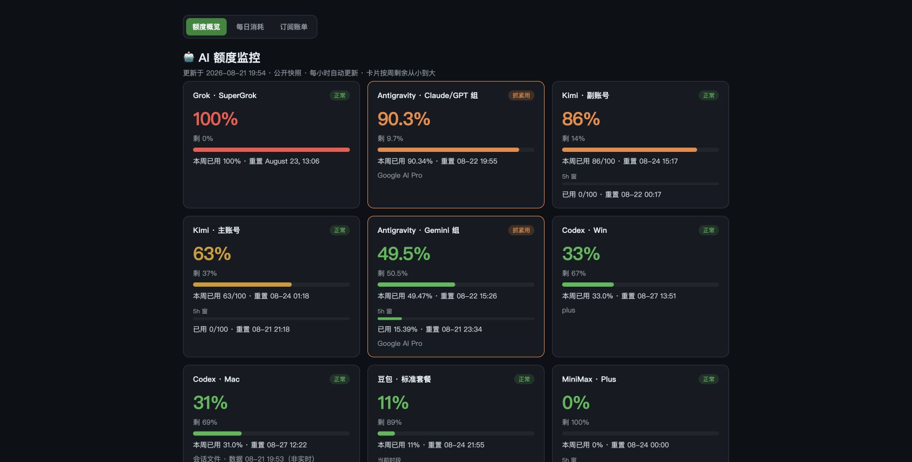
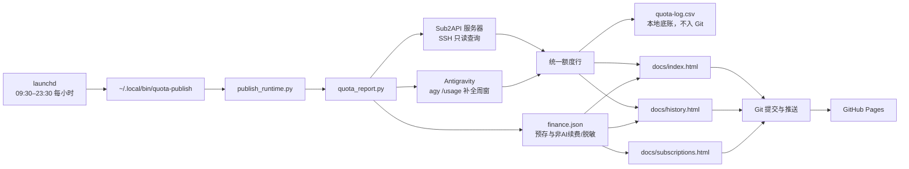
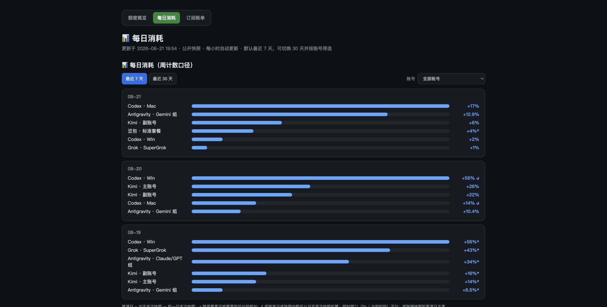

# AI Quota Monitor：项目流程与设计说明

这个项目把多种 AI 产品互不相同的额度口径，归一化成一个适合个人日常决策的公开仪表盘。核心问题不是“抓到一个百分比”，而是保证这个数字来源明确、刷新时间可信、跨周计算不误导，并且查询本身不消耗模型额度。



## 1. 目标与原则

项目围绕五条原则设计：

1. **周额度优先**：主卡片展示供应商实际提供的周已用和剩余比例；没有周窗口时显示未知。
2. **其他窗口独立展示**：5 小时窗、“当前时段”或模型窗口显示为子进度条，不混入每日周额度消耗。
3. **不发模型任务**：所有查询都是只读接口或无消耗状态探针（如 `agy /usage`），不发送提示词。
4. **宁可明确使用缓存，也不伪装实时**：采集失败时保留最后一份有效数字，但停止提醒并标明失败原因。
5. **公开内容最小化**：只发布经脱敏规则处理后的额度、账单和汇总；凭据、银行/实名、本地会话及详细日志不进入仓库。

## 2. 端到端数据流



定时入口安装在 `~/.local/bin`，是为了避开 macOS 对 Documents 目录中后台 Shell 脚本的 TCC 限制。它只负责调用仓库内唯一的 Python 发布器；手动执行 `publish.sh` 也进入同一个发布器，避免两套逻辑漂移。

## 3. 各数据源如何取数

| 数据源 | 方式 | 是否产生模型 token | 主要限制 |
|---|---|---:|---|
| Kimi for Coding | Sub2API CN 额度接口 | 否 | 配置服务器账号映射；明确区分 5h 与周窗口 |
| Codex（OpenAI 多账号） | 在服务器读取 Sub2API 当前凭据，GET 官方用量 | 否 | 不调用会触发模型探针或自动重置的管理路径 |
| MiniMax | Sub2API CN 额度接口 | 否 | 只取本次返回的窗口，缺少周窗口时不补 0% |
| Antigravity | Sub2API 分模型额度 + `agy /usage` | 否 | 补全 Flash / Claude 组周窗口与刷新时间 |

具体权限、私有配置与只读查询边界见 [Sub2API 额度接入](sub2api-quota.md)。

Grok、豆包 DOM 与旧本机 CLI 采集器已下线移除；历史底账中的旧停用账号记录会在展示层过滤。

所有适配器最终输出统一字段：来源名称、状态、周已用百分比、周重置时间，以及可选的短时窗口百分比和重置时间。动态文本进入 HTML 前统一打码邮箱、按 `finance.json` 应用 `public_replacements` 公开替换规则并转义；本地静态看板、实时服务和公开页均遵循脱敏隔离规则，本地底账中的账号标识保持连续。

## 4. 额度与提醒口径

### 周额度

- 主百分比是“本周已用”，剩余量按 `100 - used_pct` 计算。
- 卡片按周剩余从少到多排列，最需要处理的账号靠前。
- 百分比必须有限且非负；CN 供应商允许的超额值保留真实数字，进度条限制在 100% 内，剩余为 0。其他来源仍要求 `0–100`；缺失与非法值不会填成 0%。

### 短时窗口

- Codex、Kimi、MiniMax、Antigravity 等来源可显示 5 小时窗。
- 短时窗口不计入“每日消耗”，否则会把同一使用行为重复计算。
- Kimi 的使用建议只看周窗口：周刷新还很远时，不因为 5 小时窗即将刷新而提示“抓紧用”。
- 周额度已用完（剩余 ≤ 3%）时，短时窗口的剩余同样无法使用，不提示“抓紧用”，卡片改显示“已用完”。

### 每日消耗

- 普通日：当天最后一份周快照减去前一天最后一份周快照。
- 周重置日：把重置前消耗和重置后消耗分段相加。
- 快照中断或缺少自然日时，只从当天第一份可信快照开始计算，避免把数日用量全部记到恢复当天。
- 同一窗口内偶发的数值回跳视为数据抖动，不伪造一次周重置。

## 5. 页面拆分

- `docs/index.html`：额度概览、短时窗口、紧急提醒和最近两天摘要。
- `docs/history.html`：7/30 天切换、账号筛选和每日消耗。
- `docs/subscriptions.html`：AI 订阅、近期到期 KPI（含 `ikuuu` 等非 AI 续费预警）、历史充值与 ChatGPT 预存计划。

ChatGPT 预存余额与非 AI 服务（如 `ikuuu`）到期信息从私有财务笔记读取，笔记路径、授权展示名及 `public_replacements` 公开脱敏规则通过 `QUOTA_FINANCE_MD` 或本机私有配置 `~/.cache/ai-quota-monitor/finance.json`（权限 `0600`）提供，不写入公开仓库。每条预存记录包含账号、记录日期、余额、每次扣费、可覆盖的扣费日和下次需补款的扣费日；余额是人工核对的日期快照，未来扣款仅作为计划，不自动记为已发生支出。默认只显示在本地静态看板和实时服务中；用户明确授权公开的条目可填写可选的“公开展示名”列，公开订阅页仅使用该展示名及余额、日期字段，不输出原始账号名。未填写公开展示名的条目仍仅在本地显示。



拆成三个页面是为了避免单页持续增长后难以浏览，也让额度决策、历史分析和账单盘点各自保持清晰。

已下线或未付费的账号不再接入监控；公开过滤名单位于本机权限为 `0600` 的 `~/.cache/ai-quota-monitor/public-hidden-accounts.json`；缺失或无效时停止生成公开页面。其他来源、授权公开的余额计划及非 AI 续费服务继续展示。

## 6. 定时、睡眠、断网与发布

- 当前 LaunchAgent 使用 `StartCalendarInterval`，每天 09:30–23:30 每小时运行一次。
- Mac 睡眠期间错过多个时间点，唤醒后通常合并补跑一次，而不是逐小时补齐。
- Mac 关机期间不会运行；当前 `RunAtLoad=false`，开机登录后等待下一个计划时间。
- 没有网络时 launchd 仍会启动，但联网数据源或 GitHub 推送可能失败；下一个有网的计划任务会再次尝试，并推送本地尚未同步的提交。
- 只有三个公开 HTML 页面会进入自动快照提交；发布器不会顺带提交用户已经暂存的其他文件。

## 7. 隐私与安全边界

公开仓库包含用户明确选择公开的额度与费用汇总，但以下内容不会发布：

- API key、Cookie、登录 Token、Authorization header；
- 真实姓名、银行卡/开户行名称、家庭称呼与未打码邮箱（公开页通过 `public_replacements` 与邮箱掩码剔除）；
- `quota-log.csv` 与本地 `quota-dashboard.html`；
- CLI 会话原文、SSH 私钥和本机配置（`sub2api.json`、`finance.json`、`public-hidden-accounts.json`）。

## 8. 失败处理

| 场景 | 页面行为 |
|---|---|
| 单个数据源不可用 | 保留其他成功账号；公开发布仍受既有异常数量门槛限制 |
| Sub2API 配置损坏 | 命令行停止写入；实时看板保留上次快照并标为缓存 |
| Sub2API 账号读取失败 | 只重试该账号；仍失败且存在最近快照缓存时降级保留缓存，不写成 0% 样本 |
| 页面动态文本含 HTML | 输出前转义，避免注入公开页面 |
| GitHub 推送失败 | 保留本地提交，等待后续计划任务再次推送 |

## 9. 测试与验收

```bash
python3 -m unittest discover -s tests -q
python3 -m py_compile quota_report.py sub2api_quota.py publish_runtime.py scripts/sub2api_quota_snapshot.py
bash -n publish.sh scripts/*.sh
```

关键运行时验收包括：

- launchd smoke 输出 `INSTALL_RUNTIME_PASS` 且退出码为 0；
- 完整 launchd 流程必须生成三页、提交、推送，并由 GitHub Pages 构建同一提交；
- 线上页面的生成时间与额度字段必须和提交内容一致，且公开产物零明文邮箱/实名/银行名泄露。

## 10. 主要文件

- [`quota_report.py`](../quota_report.py)：Sub2API 归一化、Antigravity 周窗口补全、每日计算和 HTML 生成。
- [`sub2api_quota.py`](../sub2api_quota.py)：私有映射、SSH 读取、窗口校验和账号级重试。
- [`scripts/sub2api_quota_snapshot.py`](../scripts/sub2api_quota_snapshot.py)：服务器内受限用量查询，不返回凭据。
- [`publish_runtime.py`](../publish_runtime.py)：唯一的生成、提交和推送流程。
- [`publish.sh`](../publish.sh)：手动发布入口。
- [`scripts/quota-publish-launchd.sh`](../scripts/quota-publish-launchd.sh)：安装到 Documents 外的稳定 launchd 入口。
- [`tests/`](../tests/)：额度计算、隐私、HTML 转义、运行时和发布回归测试。

项目选择的是“可解释、可验证的个人自动化”，而不是追求不可审计的全自动抓取：每一个数字都能说明来源，每一次降级都能在页面上看见，每一个定时发布步骤都能用本地测试和远端提交复核。
